# Design check

Tokens changed to match the mockups: none. The tokens already carry the mockups' primary #4f46e5, text #0f172a, divider #e2e8f0, Inter (loaded) and 4 px radius; the monospace face of user names is JetBrains Mono (loaded), as in the catalog.
Measured with design-measure.mjs against a production build (`next build`, `next start`) with a fresh database. Signed-on screens were measured after a real sign-on. Each screen was fixed and measured a second time (status icon tint and tone, spacing, user-name panel, profile breadcrumb).

## Differences common to the mockups (reasons)

- C1. Header, rail and footer entries of later capabilities: Cart, Orders, Sales charts, Inventory, the cart button, the "Admin entries need the administrator role." note and the footer links. Their pages do not exist yet, so a link would lead to nothing. The approved site shell decides the shell; these are its later-capability entries.
- C2. Copy fixed by the locked acceptance tests (tests/acceptance/customer-accounts, design.md SD8): button "Sign on" (mockup "Sign in"), "Remember my user name" (mockup adds "on this device"), heading "Sign-in failed" (mockup "We couldn’t sign you in") above the sign-on form, "You have signed off" (mockup "You’ve signed off"), and a "Sign up" link on the sign-in page instead of the inline sign-up form ("Choose a user name", "Create account", "0 / 25" live on /signup). Required by acceptance criteria 'Sign-in routing and error screens', 'Sign-up from sign-in page' and 'Sign-off discards session'.
- C3. Sample data in the mockups: the user name j2ee, the name Jane, the pre-filled contact, address and card ending 4242, the 28-character user name, the Checkout note on the sign-in page.
- C4. The mockup shows the account slot only as "Sign in"; the built header shows the user name and a "Sign off" button when signed on (required by the locked sign-off test), and the language button reads "English (United States)" as the approved shell's language control does.
- C5. The profile mockup shows the refused-save state and a second "Save profile" button at the top. The built page shows the alert and the field error after a refused save (e2e SWHM3-C-0155), not on first load, and has one "Save profile" button because the locked test requires exactly one.
- C6. `position` and `box` lines are consequences of C1 to C5 (a shifted rail group, a different button label); none names a spacing token of its own.

## SWHM3-MCK-29 · Sign in (/signin, signed off, 1440)
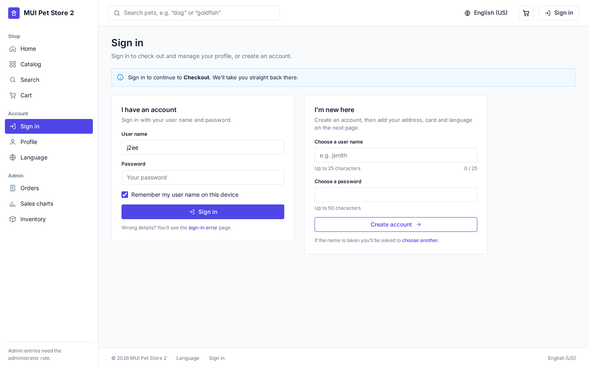 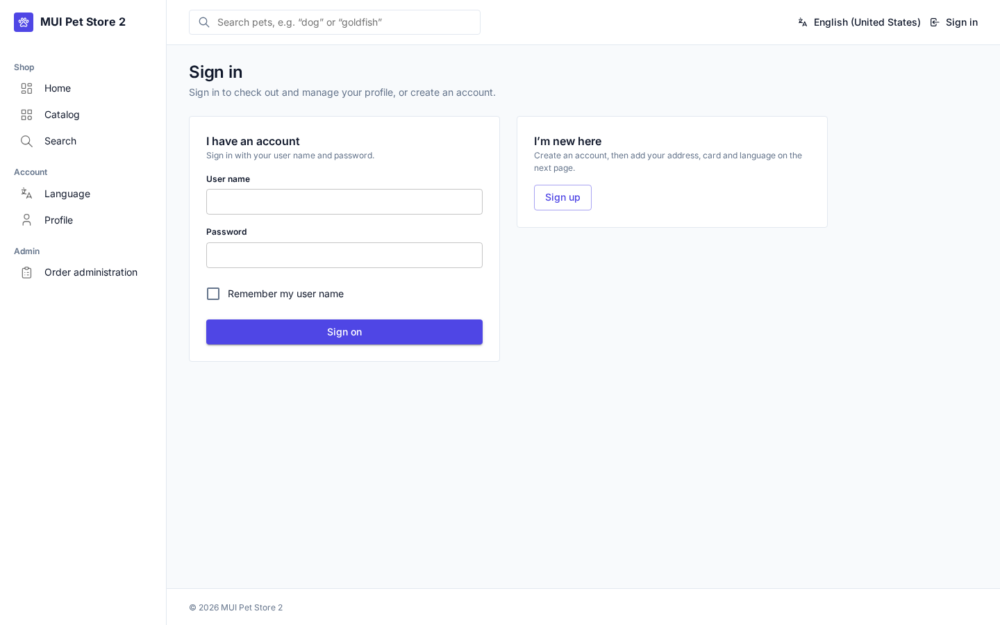 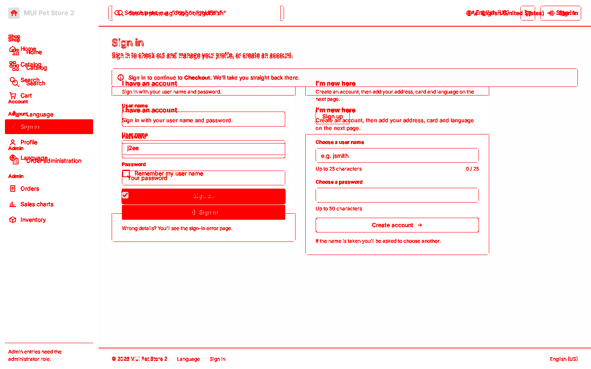

Measured: 6.9% of pixels differ, 47 differences.

Differences left:

- missing in built: "Cart" (C1 to C5)
- missing in built: "Orders" (C1 to C5)
- missing in built: "Sales charts" (C1 to C5)
- missing in built: "Inventory" (C1 to C5)
- missing in built: "Admin entries need the administrator role." (C1 to C5)
- missing in built: "English (US)" (C1 to C5)
- missing in built: "Sign in to continue to Checkout. We’ll take you straight back there." (C1 to C5)
- missing in built: "Checkout" (C1 to C5)
- missing in built: "j2ee" (C1 to C5)
- missing in built: "Remember my user name on this device" (C1 to C5)
- missing in built: "Wrong details? You’ll see the sign-in error page." (C1 to C5)
- missing in built: "sign-in error" (C1 to C5)
- missing in built: "Choose a user name" (C1 to C5)
- missing in built: "Up to 25 characters" (C1 to C5)
- missing in built: "0 / 25" (C1 to C5)
- missing in built: "Choose a password" (C1 to C5)
- missing in built: "Up to 50 characters" (C1 to C5)
- missing in built: "Create account" (C1 to C5)
- missing in built: "If the name is taken you’ll be asked to choose another." (C1 to C5)
- missing in built: "choose another" (C1 to C5)
- only in built: "Order administration" (C1 to C5)
- only in built: "English (United States)" (C1 to C5)
- only in built: "Remember my user name" (C1 to C5)
- only in built: "Sign on" (C1 to C5)
- only in built: "Sign up" (C1 to C5)
- style and layout lines: background ×1, box ×3, color ×2, font ×1, position ×13, radius ×1, size ×1 (C1 to C6)

## SWHM3-MCK-30 · Sign in · Mobile (/signin, signed off, 390)
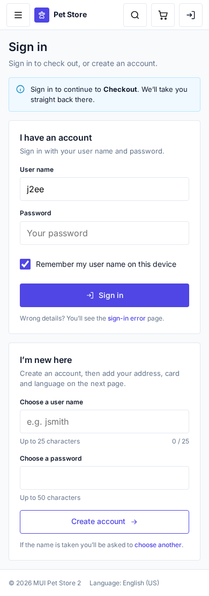 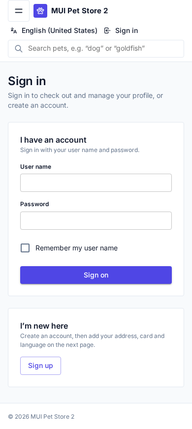 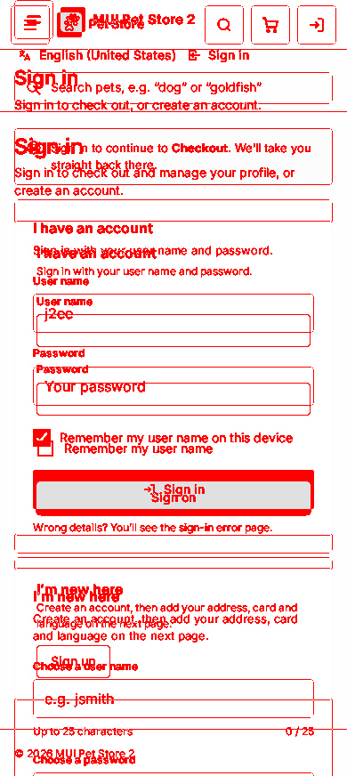

Measured: 13.1% of pixels differ, 38 differences.

Differences left:

- missing in built: "Open menu" (C1 to C5)
- missing in built: "Pet Store" (C1 to C5)
- missing in built: "Search" (C1 to C5)
- missing in built: "Cart" (C1 to C5)
- missing in built: "Sign in to check out, or create an account." (C1 to C5)
- missing in built: "Sign in to continue to Checkout. We’ll take you straight back there." (C1 to C5)
- missing in built: "Checkout" (C1 to C5)
- missing in built: "j2ee" (C1 to C5)
- missing in built: "Remember my user name on this device" (C1 to C5)
- missing in built: "Wrong details? You’ll see the sign-in error page." (C1 to C5)
- missing in built: "sign-in error" (C1 to C5)
- missing in built: "Choose a user name" (C1 to C5)
- missing in built: "Up to 25 characters" (C1 to C5)
- missing in built: "0 / 25" (C1 to C5)
- missing in built: "Choose a password" (C1 to C5)
- missing in built: "Up to 50 characters" (C1 to C5)
- missing in built: "Create account" (C1 to C5)
- missing in built: "If the name is taken you’ll be asked to choose another." (C1 to C5)
- missing in built: "choose another" (C1 to C5)
- missing in built: "Language: English (US)" (C1 to C5)
- only in built: "Open the menu" (C1 to C5)
- only in built: "MUI Pet Store 2" (C1 to C5)
- only in built: "Search the catalog" (C1 to C5)
- only in built: "English (United States)" (C1 to C5)
- only in built: "Sign in to check out and manage your profile, or create an account." (C1 to C5)
- only in built: "Remember my user name" (C1 to C5)
- only in built: "Sign on" (C1 to C5)
- only in built: "Sign up" (C1 to C5)
- style and layout lines: box ×2, position ×7, weight ×1 (C1 to C6)

## SWHM3-MCK-31 · Sign-in error (/account/profile signed off, 1440)
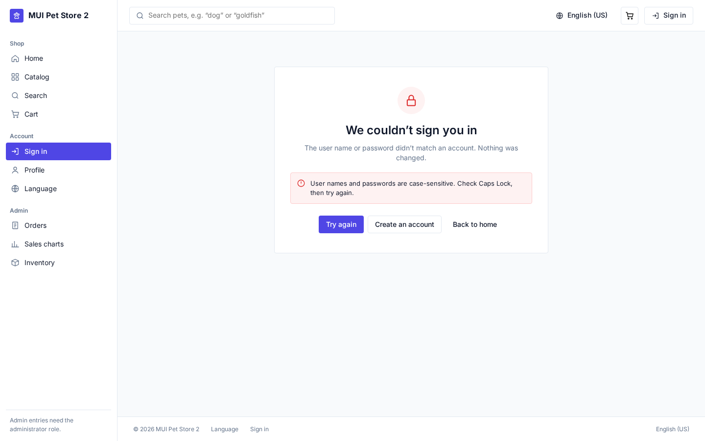 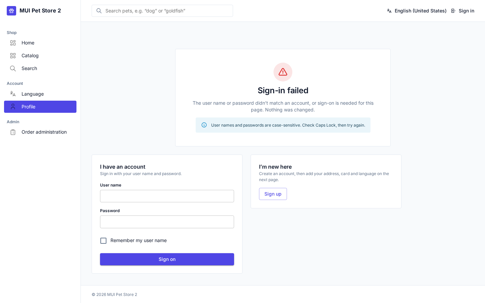 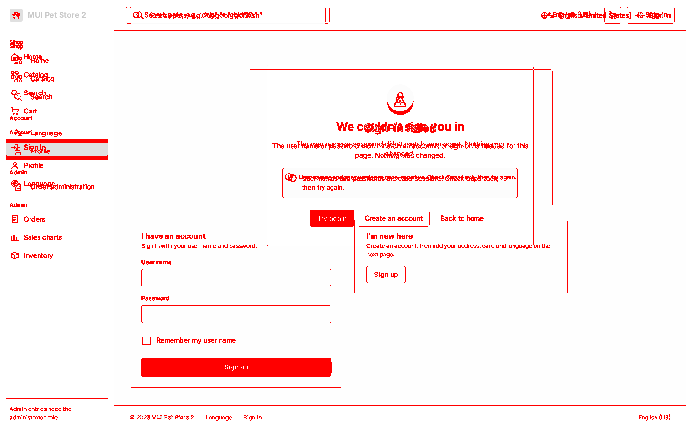

Measured: 5.3% of pixels differ, 45 differences.

Differences left:

- missing in built: "Cart" (C1 to C5)
- missing in built: "Orders" (C1 to C5)
- missing in built: "Sales charts" (C1 to C5)
- missing in built: "Inventory" (C1 to C5)
- missing in built: "Admin entries need the administrator role." (C1 to C5)
- missing in built: "English (US)" (C1 to C5)
- missing in built: "We couldn’t sign you in" (C1 to C5)
- missing in built: "The user name or password didn’t match an account. Nothing was changed." (C1 to C5)
- missing in built: "Try again" (C1 to C5)
- missing in built: "Create an account" (C1 to C5)
- missing in built: "Back to home" (C1 to C5)
- only in built: "Order administration" (C1 to C5)
- only in built: "English (United States)" (C1 to C5)
- only in built: "Sign-in failed" (C1 to C5)
- only in built: "The user name or password didn’t match an account, or sign-on is needed for this page. Nothing was changed." (C1 to C5)
- only in built: "I have an account" (C1 to C5)
- only in built: "Sign in with your user name and password." (C1 to C5)
- only in built: "User name" (C1 to C5)
- only in built: "Password" (C1 to C5)
- only in built: "on" (C1 to C5)
- only in built: "Remember my user name" (C1 to C5)
- only in built: "Sign on" (C1 to C5)
- only in built: "I’m new here" (C1 to C5)
- only in built: "Create an account, then add your address, card and language on the next page." (C1 to C5)
- only in built: "Sign up" (C1 to C5)
- style and layout lines: background ×2, box ×3, color ×4, font ×1, position ×7, radius ×1, size ×1, weight ×1 (C1 to C6)

## SWHM3-MCK-32 · Sign-in error · Mobile (/account/profile signed off, 390)
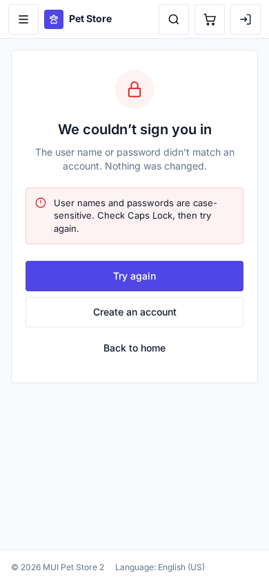 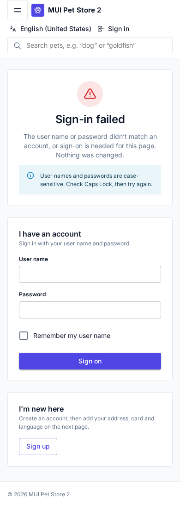 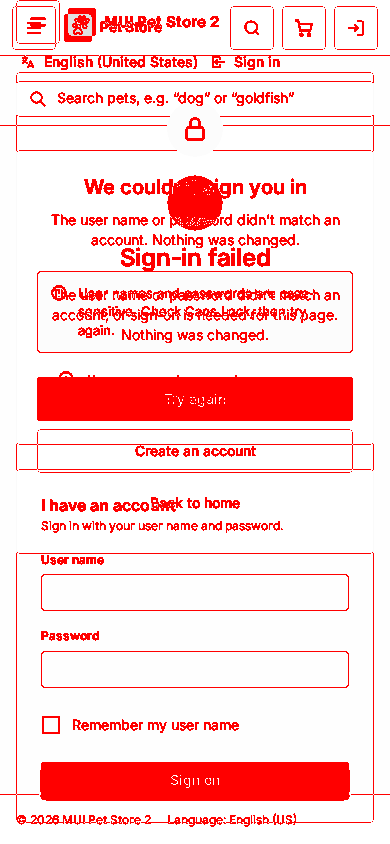

Measured: 16.8% of pixels differ, 33 differences.

Differences left:

- missing in built: "Open menu" (C1 to C5)
- missing in built: "Pet Store" (C1 to C5)
- missing in built: "Search" (C1 to C5)
- missing in built: "Cart" (C1 to C5)
- missing in built: "We couldn’t sign you in" (C1 to C5)
- missing in built: "The user name or password didn’t match an account. Nothing was changed." (C1 to C5)
- missing in built: "Try again" (C1 to C5)
- missing in built: "Create an account" (C1 to C5)
- missing in built: "Back to home" (C1 to C5)
- missing in built: "Language: English (US)" (C1 to C5)
- only in built: "Open the menu" (C1 to C5)
- only in built: "MUI Pet Store 2" (C1 to C5)
- only in built: "Search the catalog" (C1 to C5)
- only in built: "English (United States)" (C1 to C5)
- only in built: "Sign-in failed" (C1 to C5)
- only in built: "The user name or password didn’t match an account, or sign-on is needed for this page. Nothing was changed." (C1 to C5)
- only in built: "I have an account" (C1 to C5)
- only in built: "Sign in with your user name and password." (C1 to C5)
- only in built: "User name" (C1 to C5)
- only in built: "Password" (C1 to C5)
- only in built: "on" (C1 to C5)
- only in built: "Remember my user name" (C1 to C5)
- only in built: "Sign on" (C1 to C5)
- only in built: "I’m new here" (C1 to C5)
- only in built: "Create an account, then add your address, card and language on the next page." (C1 to C5)
- only in built: "Sign up" (C1 to C5)
- style and layout lines: box ×2, color ×1, position ×3, weight ×1 (C1 to C6)

## SWHM3-MCK-33 · Duplicate account (/user-creation-error?reason=duplicate, 1440)
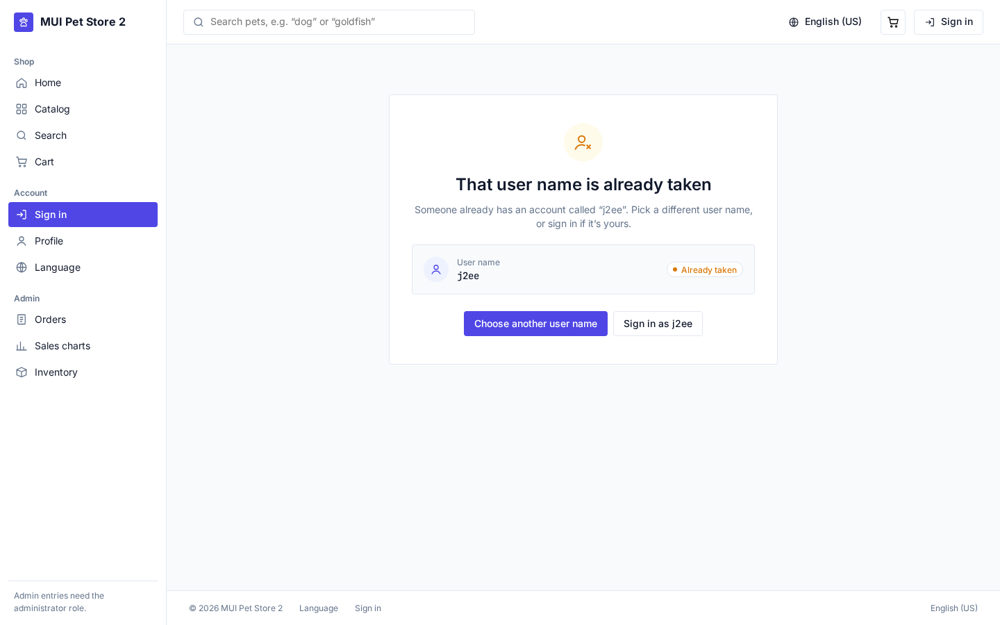  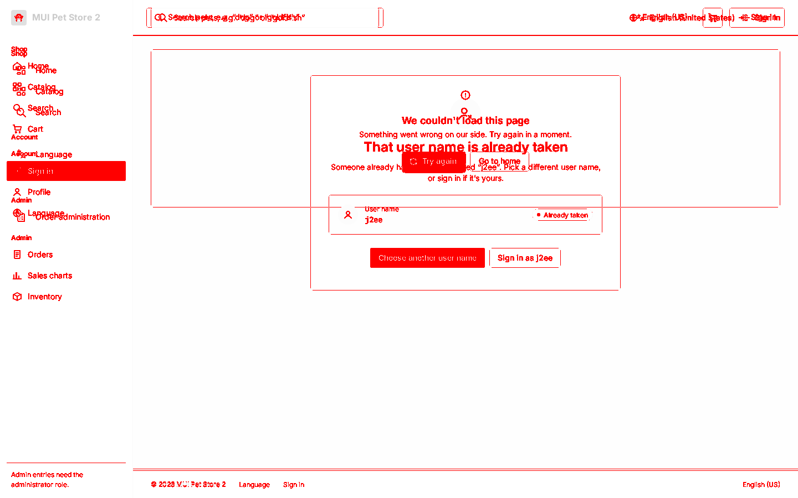

Measured: 4.2% of pixels differ, 33 differences.

Differences left:

- missing in built: "Cart" (C1 to C5)
- missing in built: "Orders" (C1 to C5)
- missing in built: "Sales charts" (C1 to C5)
- missing in built: "Inventory" (C1 to C5)
- missing in built: "Admin entries need the administrator role." (C1 to C5)
- missing in built: "English (US)" (C1 to C5)
- missing in built: "That user name is already taken" (C1 to C5)
- missing in built: "Someone already has an account called “j2ee”. Pick a different user name, or sign in if it’s yours." (C1 to C5)
- missing in built: "User name" (C1 to C5)
- missing in built: "j2ee" (C1 to C5)
- missing in built: "Already taken" (C1 to C5)
- missing in built: "Choose another user name" (C1 to C5)
- missing in built: "Sign in as j2ee" (C1 to C5)
- only in built: "Order administration" (C1 to C5)
- only in built: "English (United States)" (C1 to C5)
- only in built: "We couldn't load this page" (C1 to C5)
- only in built: "Something went wrong on our side. Try again in a moment." (C1 to C5)
- only in built: "Try again" (C1 to C5)
- only in built: "Go to home" (C1 to C5)
- style and layout lines: background ×1, box ×2, color ×2, font ×1, position ×6, radius ×1, size ×1 (C1 to C6)

## SWHM3-MCK-34 · Duplicate account · Mobile (same, 390)
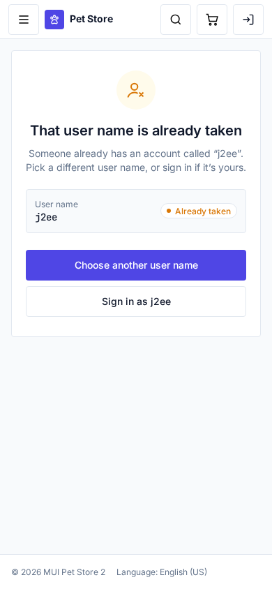  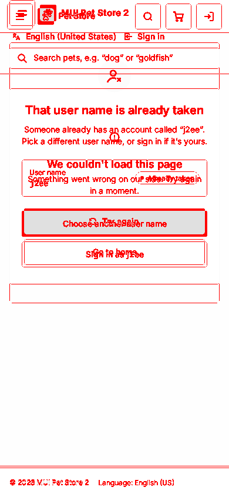

Measured: 8.0% of pixels differ, 23 differences.

Differences left:

- missing in built: "Open menu" (C1 to C5)
- missing in built: "Pet Store" (C1 to C5)
- missing in built: "Search" (C1 to C5)
- missing in built: "Cart" (C1 to C5)
- missing in built: "That user name is already taken" (C1 to C5)
- missing in built: "Someone already has an account called “j2ee”. Pick a different user name, or sign in if it’s yours." (C1 to C5)
- missing in built: "User name" (C1 to C5)
- missing in built: "j2ee" (C1 to C5)
- missing in built: "Already taken" (C1 to C5)
- missing in built: "Choose another user name" (C1 to C5)
- missing in built: "Sign in as j2ee" (C1 to C5)
- missing in built: "Language: English (US)" (C1 to C5)
- only in built: "Open the menu" (C1 to C5)
- only in built: "MUI Pet Store 2" (C1 to C5)
- only in built: "Search the catalog" (C1 to C5)
- only in built: "English (United States)" (C1 to C5)
- only in built: "We couldn't load this page" (C1 to C5)
- only in built: "Something went wrong on our side. Try again in a moment." (C1 to C5)
- only in built: "Try again" (C1 to C5)
- only in built: "Go to home" (C1 to C5)
- style and layout lines: box ×1, position ×1, weight ×1 (C1 to C6)

## SWHM3-MCK-35 · Account couldn’t be created (/user-creation-error, 1440)
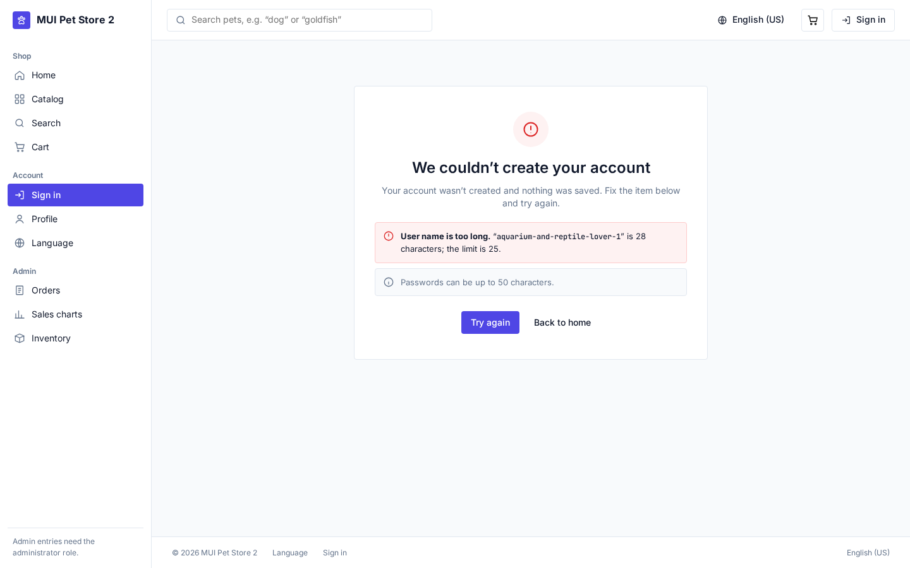 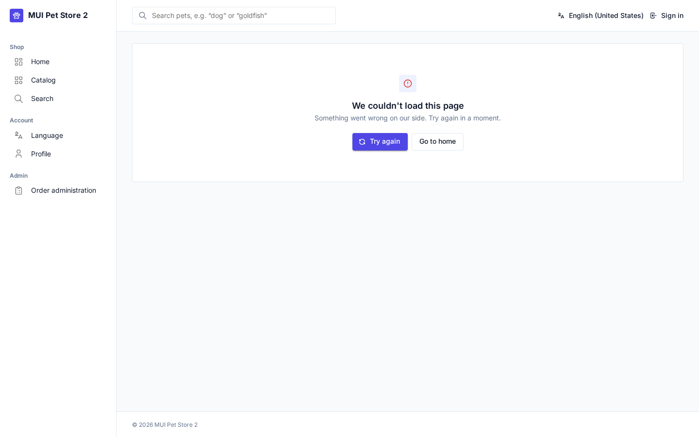 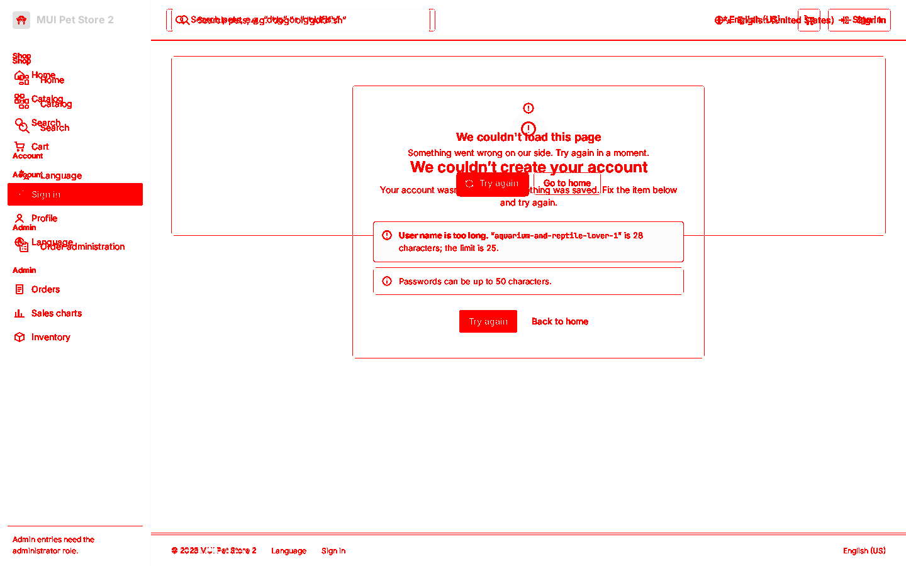

Measured: 4.1% of pixels differ, 34 differences.

Differences left:

- missing in built: "Cart" (C1 to C5)
- missing in built: "Orders" (C1 to C5)
- missing in built: "Sales charts" (C1 to C5)
- missing in built: "Inventory" (C1 to C5)
- missing in built: "Admin entries need the administrator role." (C1 to C5)
- missing in built: "English (US)" (C1 to C5)
- missing in built: "We couldn’t create your account" (C1 to C5)
- missing in built: "Your account wasn’t created and nothing was saved. Fix the item below and try again." (C1 to C5)
- missing in built: "User name is too long. “aquarium-and-reptile-lover-1” is 28 characters; the limit is 25." (C1 to C5)
- missing in built: "User name is too long." (C1 to C5)
- missing in built: "aquarium-and-reptile-lover-1" (C1 to C5)
- missing in built: "Passwords can be up to 50 characters." (C1 to C5)
- missing in built: "Back to home" (C1 to C5)
- only in built: "Order administration" (C1 to C5)
- only in built: "English (United States)" (C1 to C5)
- only in built: "We couldn't load this page" (C1 to C5)
- only in built: "Something went wrong on our side. Try again in a moment." (C1 to C5)
- only in built: "Go to home" (C1 to C5)
- style and layout lines: background ×1, box ×3, color ×2, font ×1, position ×7, radius ×1, size ×1 (C1 to C6)

## SWHM3-MCK-36 · Account couldn’t be created · Mobile (same, 390)
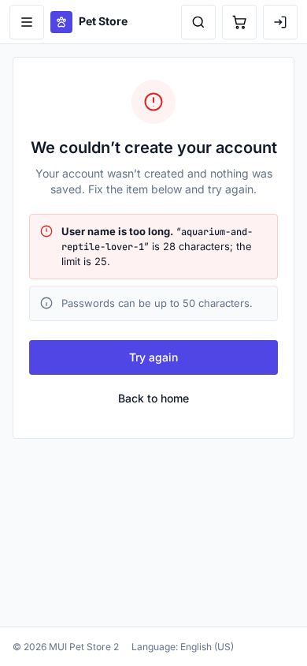  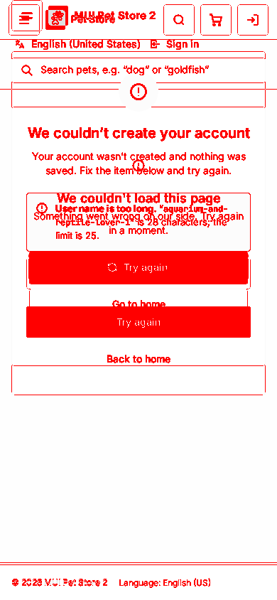

Measured: 15.3% of pixels differ, 23 differences.

Differences left:

- missing in built: "Open menu" (C1 to C5)
- missing in built: "Pet Store" (C1 to C5)
- missing in built: "Search" (C1 to C5)
- missing in built: "Cart" (C1 to C5)
- missing in built: "We couldn’t create your account" (C1 to C5)
- missing in built: "Your account wasn’t created and nothing was saved. Fix the item below and try again." (C1 to C5)
- missing in built: "User name is too long. “aquarium-and-reptile-lover-1” is 28 characters; the limit is 25." (C1 to C5)
- missing in built: "User name is too long." (C1 to C5)
- missing in built: "aquarium-and-reptile-lover-1" (C1 to C5)
- missing in built: "Passwords can be up to 50 characters." (C1 to C5)
- missing in built: "Back to home" (C1 to C5)
- missing in built: "Language: English (US)" (C1 to C5)
- only in built: "Open the menu" (C1 to C5)
- only in built: "MUI Pet Store 2" (C1 to C5)
- only in built: "Search the catalog" (C1 to C5)
- only in built: "English (United States)" (C1 to C5)
- only in built: "We couldn't load this page" (C1 to C5)
- only in built: "Something went wrong on our side. Try again in a moment." (C1 to C5)
- only in built: "Go to home" (C1 to C5)
- style and layout lines: box ×1, position ×2, weight ×1 (C1 to C6)

## SWHM3-MCK-37 · Profile form (/account/profile, signed on, 1440)
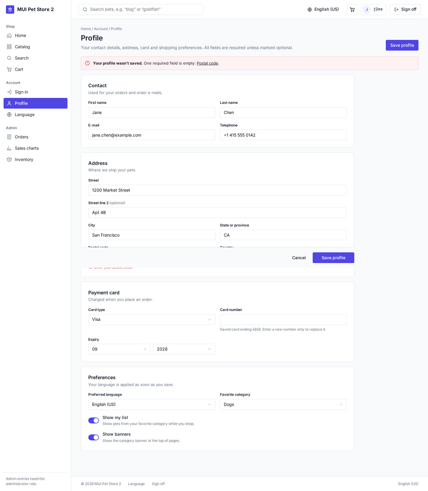 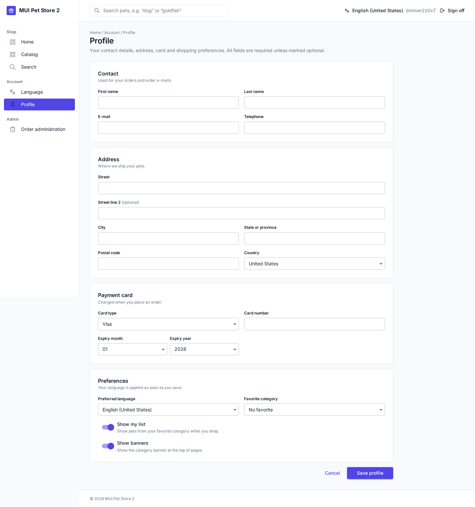 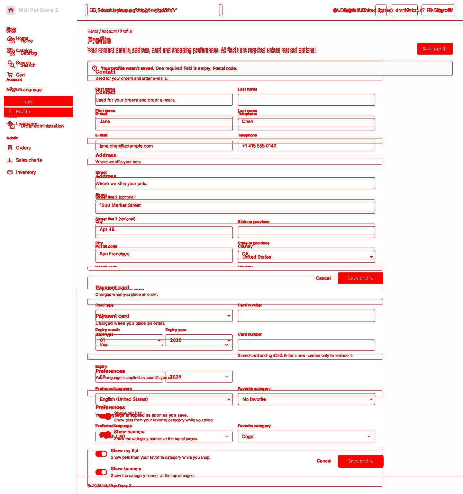

Measured: 6.2% of pixels differ, 94 differences.

Differences left:

- missing in built: "Cart" (C1 to C5)
- missing in built: "Sign in" (C1 to C5)
- missing in built: "Orders" (C1 to C5)
- missing in built: "Sales charts" (C1 to C5)
- missing in built: "Inventory" (C1 to C5)
- missing in built: "Admin entries need the administrator role." (C1 to C5)
- missing in built: "English (US)" (C1 to C5)
- missing in built: "J" (C1 to C5)
- missing in built: "j2ee" (C1 to C5)
- missing in built: "Your profile wasn’t saved. One required field is empty: Postal code." (C1 to C5)
- missing in built: "Your profile wasn’t saved." (C1 to C5)
- missing in built: "Jane" (C1 to C5)
- missing in built: "Chen" (C1 to C5)
- missing in built: "jane.chen@example.com" (C1 to C5)
- missing in built: "+1 415 555 0142" (C1 to C5)
- missing in built: "1200 Market Street" (C1 to C5)
- missing in built: "Street line 2 (optional)" (C1 to C5)
- missing in built: "Apt 4B" (C1 to C5)
- missing in built: "San Francisco" (C1 to C5)
- missing in built: "CA" (C1 to C5)
- missing in built: "Enter your postal code." (C1 to C5)
- missing in built: "Saved card ending 4242. Enter a new number only to replace it." (C1 to C5)
- missing in built: "4242" (C1 to C5)
- missing in built: "Expiry" (C1 to C5)
- missing in built: "2026 2027 2028 2029 2030 2031" (C1 to C5)
- missing in built: "English (US) Deutsch 日本語 简体中文" (C1 to C5)
- missing in built: "No favorite Fish Dogs Reptiles Cats Birds" (C1 to C5)
- only in built: "Order administration" (C1 to C5)
- only in built: "English (United States)" (C1 to C5)
- only in built: "dmmwr2z0x7" (C1 to C5)
- only in built: "Street line 2(optional)" (C1 to C5)
- only in built: "Expiry month" (C1 to C5)
- only in built: "Expiry year" (C1 to C5)
- only in built: "2026 2027 2028 2029 2030 2031 2032 2033 2034 2035 2036 2037" (C1 to C5)
- only in built: "English (United States) Deutsch (Deutschland) 日本語 (日本) 简体中文 (中国)" (C1 to C5)
- only in built: "No favorite Birds Cats Dogs Fish Reptiles" (C1 to C5)
- style and layout lines: box ×6, color ×3, font ×1, radius ×2, size ×1, weight ×1 (C1 to C6)

## SWHM3-MCK-38 · Profile form · Mobile (same, 390)
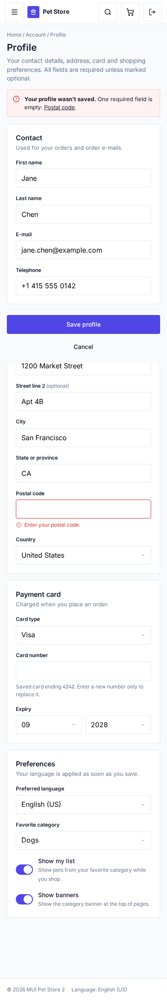 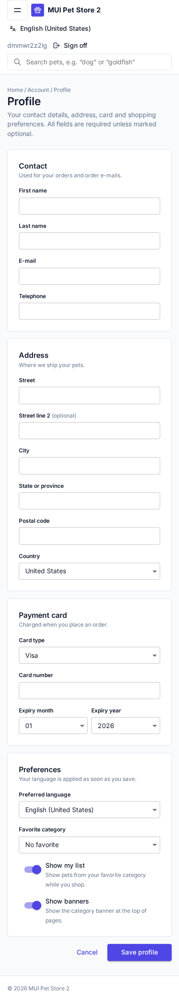 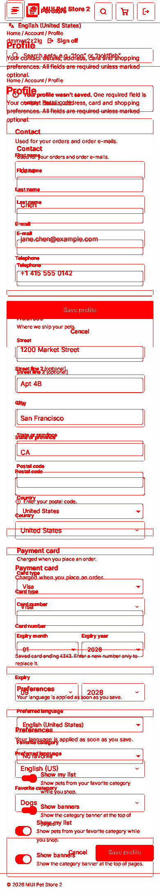

Measured: 12.3% of pixels differ, 91 differences.

Differences left:

- missing in built: "Open menu" (C1 to C5)
- missing in built: "Pet Store" (C1 to C5)
- missing in built: "Search" (C1 to C5)
- missing in built: "Cart" (C1 to C5)
- missing in built: "Sign off j2ee" (C1 to C5)
- missing in built: "Your profile wasn’t saved. One required field is empty: Postal code." (C1 to C5)
- missing in built: "Your profile wasn’t saved." (C1 to C5)
- missing in built: "Jane" (C1 to C5)
- missing in built: "Chen" (C1 to C5)
- missing in built: "jane.chen@example.com" (C1 to C5)
- missing in built: "+1 415 555 0142" (C1 to C5)
- missing in built: "1200 Market Street" (C1 to C5)
- missing in built: "Street line 2 (optional)" (C1 to C5)
- missing in built: "Apt 4B" (C1 to C5)
- missing in built: "San Francisco" (C1 to C5)
- missing in built: "CA" (C1 to C5)
- missing in built: "Enter your postal code." (C1 to C5)
- missing in built: "Saved card ending 4242. Enter a new number only to replace it." (C1 to C5)
- missing in built: "4242" (C1 to C5)
- missing in built: "Expiry" (C1 to C5)
- missing in built: "2026 2027 2028 2029 2030 2031" (C1 to C5)
- missing in built: "English (US) Deutsch 日本語 简体中文" (C1 to C5)
- missing in built: "No favorite Fish Dogs Reptiles Cats Birds" (C1 to C5)
- missing in built: "Language: English (US)" (C1 to C5)
- only in built: "Open the menu" (C1 to C5)
- only in built: "MUI Pet Store 2" (C1 to C5)
- only in built: "Search the catalog" (C1 to C5)
- only in built: "English (United States)" (C1 to C5)
- only in built: "dmmwr2z2lg" (C1 to C5)
- only in built: "Sign off" (C1 to C5)
- only in built: "Street line 2(optional)" (C1 to C5)
- only in built: "Expiry month" (C1 to C5)
- only in built: "Expiry year" (C1 to C5)
- only in built: "2026 2027 2028 2029 2030 2031 2032 2033 2034 2035 2036 2037" (C1 to C5)
- only in built: "English (United States) Deutsch (Deutschland) 日本語 (日本) 简体中文 (中国)" (C1 to C5)
- only in built: "No favorite Birds Cats Dogs Fish Reptiles" (C1 to C5)
- style and layout lines: box ×8, color ×2, radius ×1, size ×2, weight ×1 (C1 to C6)

## SWHM3-MCK-39 · Sign-on welcome (/account/welcome, signed on, 1440)
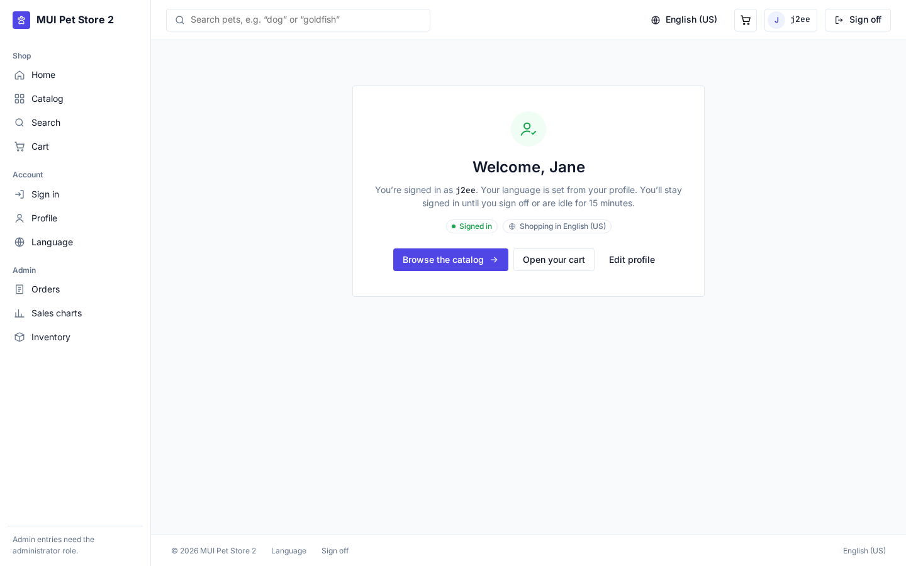 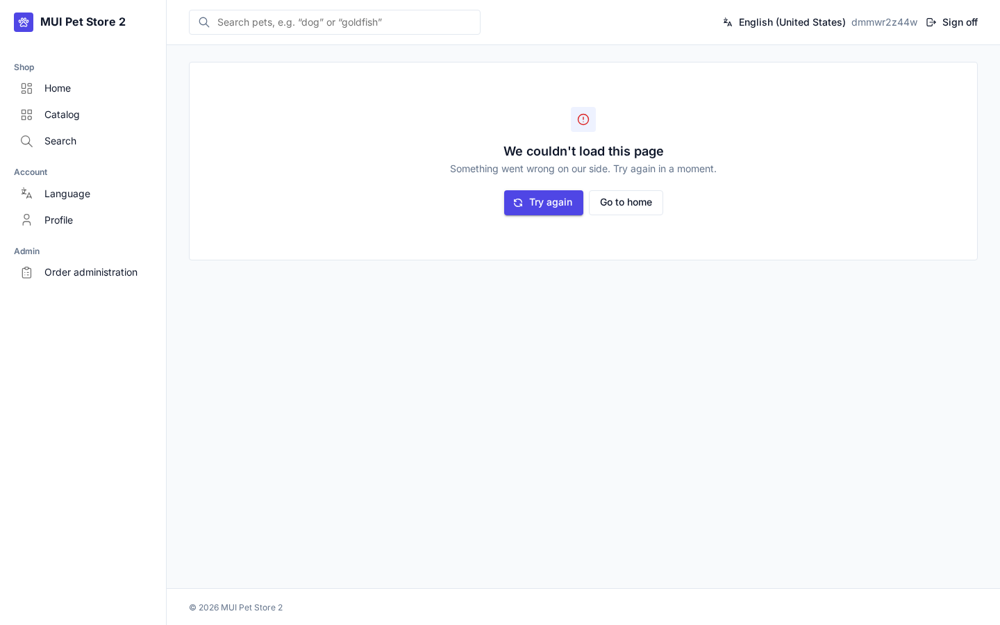 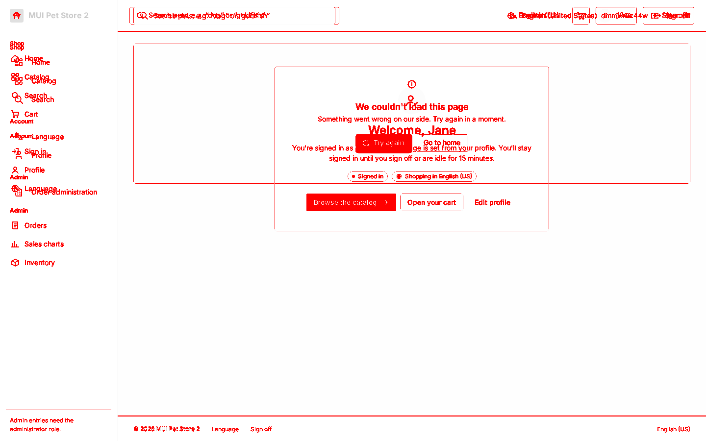

Measured: 3.6% of pixels differ, 35 differences.

Differences left:

- missing in built: "Cart" (C1 to C5)
- missing in built: "Sign in" (C1 to C5)
- missing in built: "Orders" (C1 to C5)
- missing in built: "Sales charts" (C1 to C5)
- missing in built: "Inventory" (C1 to C5)
- missing in built: "Admin entries need the administrator role." (C1 to C5)
- missing in built: "English (US)" (C1 to C5)
- missing in built: "J" (C1 to C5)
- missing in built: "j2ee" (C1 to C5)
- missing in built: "Welcome, Jane" (C1 to C5)
- missing in built: "You’re signed in as j2ee. Your language is set from your profile. You’ll stay signed in until you sign off or are idle for 15 minutes." (C1 to C5)
- missing in built: "Signed in" (C1 to C5)
- missing in built: "Shopping in English (US)" (C1 to C5)
- missing in built: "Browse the catalog" (C1 to C5)
- missing in built: "Open your cart" (C1 to C5)
- missing in built: "Edit profile" (C1 to C5)
- only in built: "Order administration" (C1 to C5)
- only in built: "English (United States)" (C1 to C5)
- only in built: "dmmwr2z44w" (C1 to C5)
- only in built: "We couldn't load this page" (C1 to C5)
- only in built: "Something went wrong on our side. Try again in a moment." (C1 to C5)
- only in built: "Try again" (C1 to C5)
- only in built: "Go to home" (C1 to C5)
- style and layout lines: box ×2, color ×1, font ×1, position ×6, radius ×1, size ×1 (C1 to C6)

## SWHM3-MCK-40 · Sign-on welcome · Mobile (same, 390)
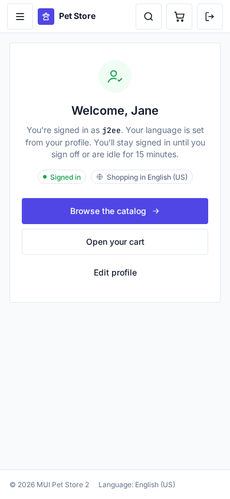 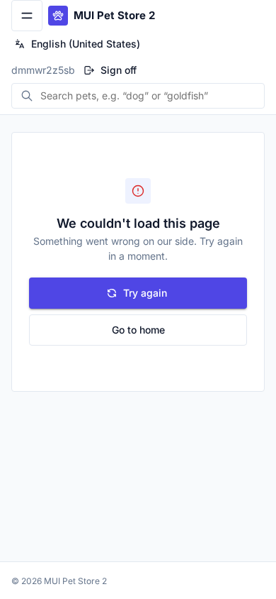 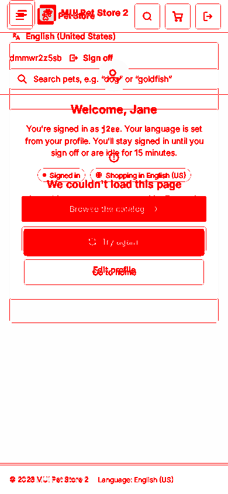

Measured: 14.8% of pixels differ, 24 differences.

Differences left:

- missing in built: "Open menu" (C1 to C5)
- missing in built: "Pet Store" (C1 to C5)
- missing in built: "Search" (C1 to C5)
- missing in built: "Cart" (C1 to C5)
- missing in built: "Sign off j2ee" (C1 to C5)
- missing in built: "Welcome, Jane" (C1 to C5)
- missing in built: "You’re signed in as j2ee. Your language is set from your profile. You’ll stay signed in until you sign off or are idle for 15 minutes." (C1 to C5)
- missing in built: "j2ee" (C1 to C5)
- missing in built: "Signed in" (C1 to C5)
- missing in built: "Shopping in English (US)" (C1 to C5)
- missing in built: "Browse the catalog" (C1 to C5)
- missing in built: "Open your cart" (C1 to C5)
- missing in built: "Edit profile" (C1 to C5)
- missing in built: "Language: English (US)" (C1 to C5)
- only in built: "Open the menu" (C1 to C5)
- only in built: "MUI Pet Store 2" (C1 to C5)
- only in built: "Search the catalog" (C1 to C5)
- only in built: "English (United States)" (C1 to C5)
- only in built: "dmmwr2z5sb" (C1 to C5)
- only in built: "Sign off" (C1 to C5)
- only in built: "We couldn't load this page" (C1 to C5)
- only in built: "Something went wrong on our side. Try again in a moment." (C1 to C5)
- only in built: "Try again" (C1 to C5)
- only in built: "Go to home" (C1 to C5)

## SWHM3-MCK-41 · Signed off (/signed-off, 1440)
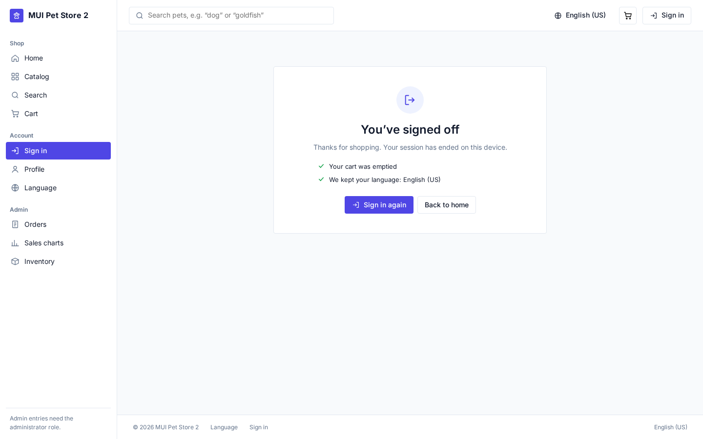  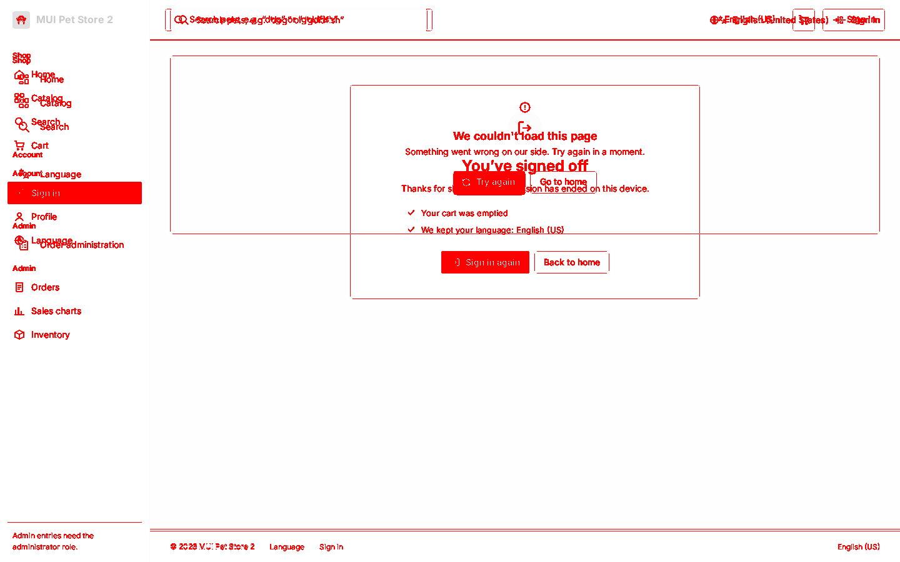

Measured: 3.8% of pixels differ, 32 differences.

Differences left:

- missing in built: "Cart" (C1 to C5)
- missing in built: "Orders" (C1 to C5)
- missing in built: "Sales charts" (C1 to C5)
- missing in built: "Inventory" (C1 to C5)
- missing in built: "Admin entries need the administrator role." (C1 to C5)
- missing in built: "English (US)" (C1 to C5)
- missing in built: "You’ve signed off" (C1 to C5)
- missing in built: "Thanks for shopping. Your session has ended on this device." (C1 to C5)
- missing in built: "Your cart was emptied" (C1 to C5)
- missing in built: "We kept your language: English (US)" (C1 to C5)
- missing in built: "Sign in again" (C1 to C5)
- missing in built: "Back to home" (C1 to C5)
- only in built: "Order administration" (C1 to C5)
- only in built: "English (United States)" (C1 to C5)
- only in built: "We couldn't load this page" (C1 to C5)
- only in built: "Something went wrong on our side. Try again in a moment." (C1 to C5)
- only in built: "Try again" (C1 to C5)
- only in built: "Go to home" (C1 to C5)
- style and layout lines: background ×1, box ×2, color ×2, font ×1, position ×6, radius ×1, size ×1 (C1 to C6)

## SWHM3-MCK-42 · Signed off · Mobile (same, 390)
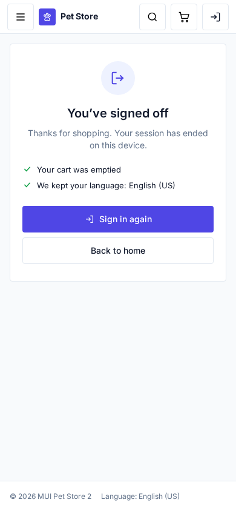 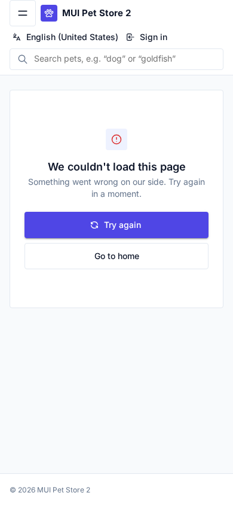 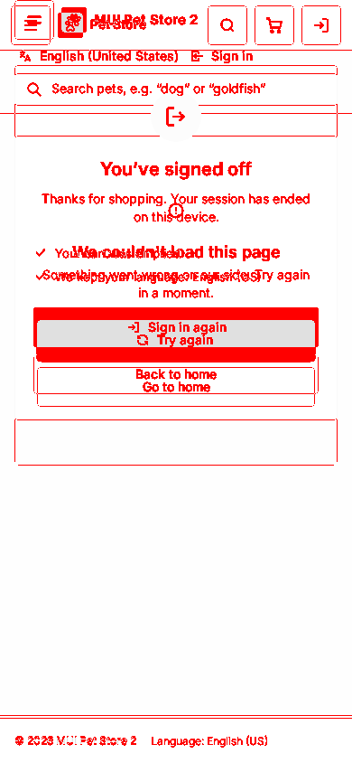

Measured: 9.2% of pixels differ, 22 differences.

Differences left:

- missing in built: "Open menu" (C1 to C5)
- missing in built: "Pet Store" (C1 to C5)
- missing in built: "Search" (C1 to C5)
- missing in built: "Cart" (C1 to C5)
- missing in built: "You’ve signed off" (C1 to C5)
- missing in built: "Thanks for shopping. Your session has ended on this device." (C1 to C5)
- missing in built: "Your cart was emptied" (C1 to C5)
- missing in built: "We kept your language: English (US)" (C1 to C5)
- missing in built: "Sign in again" (C1 to C5)
- missing in built: "Back to home" (C1 to C5)
- missing in built: "Language: English (US)" (C1 to C5)
- only in built: "Open the menu" (C1 to C5)
- only in built: "MUI Pet Store 2" (C1 to C5)
- only in built: "Search the catalog" (C1 to C5)
- only in built: "English (United States)" (C1 to C5)
- only in built: "We couldn't load this page" (C1 to C5)
- only in built: "Something went wrong on our side. Try again in a moment." (C1 to C5)
- only in built: "Try again" (C1 to C5)
- only in built: "Go to home" (C1 to C5)
- style and layout lines: box ×1, position ×1, weight ×1 (C1 to C6)
